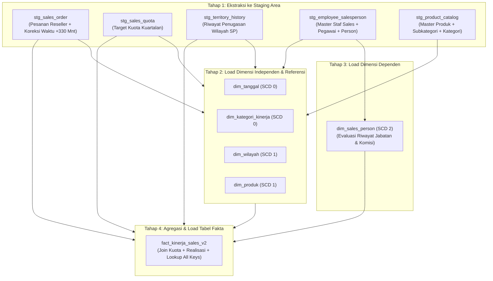

# Dokumentasi Desain ETL & Data Warehouse (Tugas Pekan 10)
**Proyek:** Data Warehouse Evaluasi Kinerja Penjualan dan Pencapaian Target (Kinerja Sales vs Target)  
**Kelompok:** Kelompok 4  
**Skema:** Star Schema Versi 2 (`StarSchema2_New.sql` / `Diagram Schema 2_New.png`)  
**Target Database:** `dw_kelompok_4` (`adn_kl4`)  
**Sumber Database:** `adventureworks2`  

---

# 2. Source-to-Target Mapping (STTM) Lengkap

## Target: dim_tanggal   (SCD: tipe 0)
Sumber utama: Generator Tanggal / Tabel Kalender Standar Kelas DW

| Kolom target | Tipe | Tabel.kolom sumber | Transformasi | Aturan NULL |
|--------------|------|--------------------|--------------|-------------|
| tanggal_key | INT | dim_tanggal.tanggal_key | tanggal ke YYYYMMDD (contoh: 20110531) | -1 untuk baris default "Tidak diketahui" |
| tanggal | DATE | dim_tanggal.tanggal | langsung (YYYY-MM-DD) | '1900-01-01' untuk key -1 |
| tahun | INT | dim_tanggal.tanggal | ekstrak tahun: `YEAR(tanggal)` | 0 untuk key -1 |
| semester | INT | dim_tanggal.tanggal | `CASE WHEN MONTH(tanggal) <= 6 THEN 1 ELSE 2 END` | 0 untuk key -1 |
| kuartal | INT | dim_tanggal.tanggal | ekstrak kuartal: `QUARTER(tanggal)` | 0 untuk key -1 |
| bulan | INT | dim_tanggal.tanggal | ekstrak bulan: `MONTH(tanggal)` | 0 untuk key -1 |
| nama_bulan | VARCHAR(15) | dim_tanggal.tanggal | nama bulan: `MONTHNAME(tanggal)` (atau nama bulan Indonesia) | 'Tidak diketahui' untuk key -1 |
| minggu_dalam_tahun | INT | dim_tanggal.tanggal | ekstrak minggu: `WEEK(tanggal)` / `WEEKOFYEAR(tanggal)` | 0 untuk key -1 |
| tanggal_dalam_bulan | INT | dim_tanggal.tanggal | ekstrak hari dalam bulan: `DAY(tanggal)` | 0 untuk key -1 |
| hari_dalam_minggu | INT | dim_tanggal.tanggal | ekstrak indeks hari: `DAYOFWEEK(tanggal)` | 0 untuk key -1 |
| nama_hari | VARCHAR(15) | dim_tanggal.tanggal | nama hari: `DAYNAME(tanggal)` (atau nama hari Indonesia) | 'Tidak diketahui' untuk key -1 |
| is_akhir_pekan | TINYINT(1) | dim_tanggal.tanggal | `CASE WHEN DAYOFWEEK(tanggal) IN (1, 7) THEN 1 ELSE 0 END` | 0 untuk key -1 |

---

## Target: dim_wilayah   (SCD: tipe 1)
Sumber utama: sales.salesterritory (sales_salesterritory), person.countryregion (person_countryregion)

| Kolom target | Tipe | Tabel.kolom sumber | Transformasi | Aturan NULL |
|--------------|------|--------------------|--------------|-------------|
| wilayah_key | INT | - | surrogate key dari DW (AUTO_INCREMENT) | - |
| territory_id | INT | sales_salesterritory.TerritoryID | langsung (natural key) | NULL untuk baris default "Tidak diketahui / Unassigned" |
| nama_wilayah | VARCHAR(50) | sales_salesterritory.Name | langsung | 'Tidak diketahui' jika NULL / Unassigned |
| kode_negara | VARCHAR(3) | sales_salesterritory.CountryRegionCode | langsung | 'NA' jika NULL |
| nama_negara | VARCHAR(50) | person_countryregion.Name | lookup via CountryRegionCode | 'Tidak diketahui' jika NULL |
| grup_wilayah | VARCHAR(50) | sales_salesterritory.Group | langsung | 'Tidak diketahui' jika NULL / Unassigned |
| is_active | TINYINT(1) | - | default nilai aktif = 1 | 1 |

---

## Target: dim_sales_person   (SCD: tipe 2)
Sumber utama: sales.salesperson (sales_salesperson), humanresources.employee (humanresources_employee), person.person (person_person)

| Kolom target | Tipe | Tabel.kolom sumber | Transformasi | Aturan NULL |
|--------------|------|--------------------|--------------|-------------|
| sales_person_key | INT | - | surrogate key dari DW (AUTO_INCREMENT) | - |
| business_entity_id | INT | sales_salesperson.BusinessEntityID | langsung (natural key) | Tidak boleh NULL |
| nama_lengkap | VARCHAR(150) | person_person.FirstName, MiddleName, LastName | `CONCAT_WS(' ', FirstName, MiddleName, LastName)` | 'Tidak diketahui' jika NULL |
| jabatan | VARCHAR(100) | humanresources_employee.JobTitle | langsung (join BusinessEntityID) | 'Tidak diketahui' jika NULL |
| tanggal_masuk | DATE | humanresources_employee.HireDate | langsung (format DATE) | '1900-01-01' jika NULL |
| komisi_pct | DECIMAL(5,4) | sales_salesperson.CommissionPct | langsung | default 0.0000 jika NULL |
| bonus | DECIMAL(15,2) | sales_salesperson.Bonus | langsung | default 0.00 jika NULL |
| row_effective_date | DATE | - | tanggal efektif record SCD Tipe 2 (`CURRENT_DATE` saat load / tanggal riwayat) | `CURRENT_DATE` |
| row_expiry_date | DATE | - | tanggal kadaluarsa record SCD Tipe 2 (default record aktif = '9999-12-31') | '9999-12-31' |

---

## Target: dim_produk   (SCD: tipe 1)
Sumber utama: production.product (production_product), production.productsubcategory (production_productsubcategory), production.productcategory (production_productcategory)

| Kolom target | Tipe | Tabel.kolom sumber | Transformasi | Aturan NULL |
|--------------|------|--------------------|--------------|-------------|
| produk_key | INT | - | surrogate key dari DW (AUTO_INCREMENT) | - |
| product_id | INT | production_product.ProductID | langsung (natural key) | Tidak boleh NULL (default 0 untuk baris dummy 'Tanpa Produk') |
| nama_produk | VARCHAR(50) | production_product.Name | langsung | 'Tidak diketahui' jika NULL |
| nomor_produk | VARCHAR(25) | production_product.ProductNumber | langsung | 'Tidak diketahui' jika NULL |
| sub_kategori | VARCHAR(50) | production_productsubcategory.Name | lookup / join via ProductSubcategoryID | 'Tanpa Sub Kategori' jika NULL |
| kategori | VARCHAR(50) | production_productcategory.Name | lookup / join via ProductCategoryID | 'Tanpa Kategori' jika NULL |
| list_price | DECIMAL(15,2) | production_product.ListPrice | langsung | default 0.00 jika NULL |

---

## Target: dim_kategori_kinerja (SCD: Tipe 1)

Sumber utama: Tabel Referensi Klasifikasi Kinerja DW / Junk Dimension (ETL Rule)

| Kolom Target | Tipe | Tabel.Kolom Sumber | Transformasi | Aturan NULL |
|---|---|---|---|---|
| `kategori_kinerja_key` | INT | - | Surrogate key dari DW (AUTO_INCREMENT) | - |
| `kode_kategori` | VARCHAR(10) | - | Pemetaan kode kategori: 'TERCAPAI', 'BELUM_TERCAPAI', 'TANPA_TARGET', 'TARGET_SAJA' | Tidak boleh NULL |
| `nama_kategori` | VARCHAR(50) | - | Pemetaan label: 'Tercapai', 'Belum Tercapai', 'Tanpa Target', 'Target Tanpa Realisasi' | Tidak boleh NULL |
| `keterangan_rentang` | VARCHAR(100) | - | Deskripsi batasan: 'Realisasi >= Target (>= 100%)', 'Realisasi < Target (< 100%)', 'Realisasi ada, Target NULL (Q2 2014)', 'Target ada, Realisasi 0.00' | NULL jika tidak ada keterangan spesifik |

---

## Target: fact_kinerja_sales_v2   (grain: Satu baris per sales person per kuartal per wilayah per produk)
| Kolom target | Tipe | Tabel.kolom sumber | Transformasi | Aturan NULL |
|--------------|------|--------------------|--------------|-------------|
| tanggal_kuartal_key | INT | sales_salesorderheader.OrderDate, sales_salespersonquotahistory.QuotaDate | Koreksi waktu `DATE_ADD(orderdate, INTERVAL 330 MINUTE)`, ambil awal kuartal kalender, tanggal ke YYYYMMDD, lookup `dim_tanggal.tanggal_key` | -1 jika tanggal tidak valid |
| sales_person_key | INT | sales_salesorderheader.SalesPersonID, sales_salespersonquotahistory.BusinessEntityID | lookup ke `dim_sales_person.sales_person_key` berdasarkan BusinessEntityID | -1 jika sales person tidak ditemukan |
| wilayah_key | INT | sales_salesterritoryhistory.TerritoryID, sales_salesperson.TerritoryID | Wilayah penugasan kuartalan akhir periode (atau fallback ke territoryid sales person), lookup ke `dim_wilayah.wilayah_key` | 0 (baris 'Tidak diketahui / Unassigned' di `dim_wilayah`) |
| produk_key | INT | sales_salesorderdetail.ProductID | lookup ke `dim_produk.produk_key` berdasarkan ProductID | 0 (baris 'Tanpa Produk / Non-Product' jika ada baris kuota murni) |
| target_penjualan | DECIMAL(15,2) | sales_salespersonquotahistory.SalesQuota | Kuota target penjualan kuartalan sales person dari sistem sumber | NULL jika kuartal tidak memiliki target kuota (misal: 2014 Q2) |
| realisasi_penjualan | DECIMAL(15,2) | sales_salesorderdetail.LineTotal | `SUM(LineTotal)` transaksi reseller ber-salesperson dalam kuartal bersangkutan | 0.00 jika hanya terdapat target tanpa realisasi penjualan |
| selisih_realisasi_target | DECIMAL(15,2) | - | formula: `realisasi_penjualan - target_penjualan` | NULL jika `target_penjualan` bernilai NULL |
| jumlah_terjual | INT | sales_salesorderdetail.OrderQty | `SUM(OrderQty)` unit produk yang terjual dalam kuartal bersangkutan | 0 jika tidak ada realisasi pesanan |
| kategori_kinerja_key | INT | - | Evaluasi performa target vs realisasi, lookup ke `dim_kategori_kinerja.kategori_kinerja_key` ('Tercapai', 'Belum Tercapai', 'Tanpa Target', 'Target Tanpa Realisasi') | lookup key untuk 'Tanpa Target' jika target NULL |

---

# 3. Strategi SCD Tiap Dimensi

Sesuai instruksi Tugas Pekan 10, berikut adalah penetapan tipe *Slowly Changing Dimension* (SCD) untuk kolom-kolom penting di setiap dimensi beserta alasan bisnis dan teknisnya:

| Nama Dimensi | Tipe SCD | Kolom Penting Terkait | Alasan Pemilihan Tipe SCD |
|---|---|---|---|
| **`dim_sales_person`** | **SCD Tipe 2** | `jabatan`, `komisi_pct`, `bonus`, `row_effective_date`, `row_expiry_date` | **Melacak Riwayat Historis Karyawan:** Staf penjualan dapat dipromosikan (misal: dari *Sales Representative* menjadi *Sales Manager*) atau mengalami perubahan persentase komisi. Jika nilai lama ditimpa (Tipe 1), transaksi penjualan masa lalu akan terikat ke jabatan atau komisi yang baru, sehingga evaluasi kinerja historis menjadi bias. Dengan **SCD Tipe 2**, ketika jabatan atau komisi berubah, baris lama ditutup (`row_expiry_date = tanggal_perubahan`) dan baris baru dibuat dengan surrogate key baru (`row_effective_date = tanggal_perubahan, row_expiry_date = '9999-12-31'`). Hal ini sangat krusial untuk menjawab **Pertanyaan Bisnis 5** (evaluasi skema komisi terhadap performa target). |
| **`dim_sales_person`** | **SCD Tipe 1** | `nama_lengkap` | **Koreksi Data / Typo:** Jika terjadi kesalahan pengetikan nama staf penjualan pada sistem operasional, nama lama cukup ditimpa dengan nama yang benar tanpa perlu membuat versi baris baru. |
| **`dim_sales_person`** | **SCD Tipe 0** | `business_entity_id`, `tanggal_masuk` | **Atribut Permanen:** ID entitas pegawai dan tanggal pertama kali bekerja (*hire date*) bersifat tetap dan tidak pernah berubah sepanjang karier pegawai. |
| **`dim_wilayah`** | **SCD Tipe 1** | `nama_wilayah`, `grup_wilayah`, `is_active` | **Pembaruan Deskripsi Terkini:** Struktur wilayah geografis pada dasarnya bersifat stabil. Jika terjadi perubahan penamaan wilayah atau perubahan pengelompokan grup teritori, nilai lama ditimpa (SCD Tipe 1). Riwayat penugasan staf ke wilayah yang berbeda antar-waktu telah dilacak secara kuartalan di tabel fakta melalui `sales_salesterritoryhistory`. |
| **`dim_wilayah`** | **SCD Tipe 0** | `territory_id`, `kode_negara` | **Kunci Alami Permanen:** Kode wilayah dan kode ISO negara (*CountryRegionCode*) bersifat permanen. |
| **`dim_produk`** | **SCD Tipe 1** | `nama_produk`, `nomor_produk`, `sub_kategori`, `kategori`, `list_price` | **Katalog Produk Standar:** Sesuai arahan sponsor kelas DW, `dim_produk` menggunakan struktur standar SCD Tipe 1. Jika ada pembaruan nama atau kategori produk, nilai lama ditimpa sehingga analisis pelaporan selalu mencerminkan struktur katalog barang terbaru. |
| **`dim_tanggal`** | **SCD Tipe 0** | Seluruh kolom (`tanggal_key`, `tanggal`, `tahun`, `semester`, `kuartal`, `bulan`, dst.) | **Dimensi Waktu Statis (Immutable):** Kalender bersifat pasti dan tidak akan pernah berubah. Sekali digenerate, data dimensi waktu tidak pernah dimodifikasi maupun ditimpa. |
| **`dim_kategori_kinerja`** | **SCD Tipe 1** | `kode_kategori`, `nama_kategori`, `keterangan_rentang` | **Pembaruan Label & Deskripsi Terkini (Junk Dimension):** Menampung kategori performa (*Tercapai*, *Belum Tercapai*, *Tanpa Target*, *Target Tanpa Realisasi*). Menggunakan **SCD Tipe 1** agar apabila manajemen melakukan penyesuaian redaksional pada label nama kategori, kode, atau penjelasan batas rentang, nilai lama langsung ditimpa (*overwrite*) sehingga seluruh tampilan laporan visual dan OLAP cube secara konsisten mencerminkan pengelompokan kebijakan terbaru. |

# 4. Daftar Urutan Load (Dari Staging Sampai Fakta)

Proses pemuatan data (*data pipeline*) di ETL Pentaho Data Integration (PDI) harus dieksekusi secara berurutan mengikuti hierarki dependensi integritas referensial (Foreign Key):

### Tabel Rincian Urutan Eksekusi Load:

| Urutan | Nama Tabel Target | Layer / Tipe Tabel | Sumber Data Ekstraksi | Deskripsi Transformasi & Tugas ETL |
|---|---|---|---|---|
| **1** | `stg_sales_order` | Staging Area | `sales_salesorderheader`, `sales_salesorderdetail` | Ekstraksi transaksi reseller (`salespersonid IS NOT NULL`), terapkan koreksi pergeseran waktu `DATE_ADD(orderdate, INTERVAL 330 MINUTE)`, simpan data nota dan detail pesanan. |
| **2** | `stg_sales_quota` | Staging Area | `sales_salespersonquotahistory` | Ekstraksi kuota target penjualan per kuartal untuk 17 sales person, validasi ketiadaan duplikat grain. |
| **3** | `stg_territory_history` | Staging Area | `sales_salesterritoryhistory` | Ekstraksi riwayat penugasan wilayah staf sales (`StartDate`, `EndDate`) untuk resolusi wilayah kuartalan. |
| **4** | `stg_employee_salesperson` | Staging Area | `sales_salesperson`, `humanresources_employee`, `person_person` | Ekstraksi gabungan profil pegawai sales: jabatan, tanggal masuk, komisi, bonus, dan nama lengkap. |
| **5** | `stg_product_catalog` | Staging Area | `production_product`, `productsubcategory`, `productcategory` | Ekstraksi data katalog produk beserta hierarki subkategori dan kategori barang. |
| **6** | `dim_tanggal` | Dimensi (SCD 0) | Skrip Kalender Standar DW | Bangkitkan tabel kalender (2011 s/d 2014) dengan atribut waktu lengkap dan baris dummy default `tanggal_key = -1`. |
| **7** | `dim_kategori_kinerja` | Dimensi (SCD 0) | Data Referensi DW | Masukkan 4 baris klasifikasi evaluasi target: *TERCAPAI*, *BELUM_TERCAPAI*, *TANPA_TARGET*, *TARGET_SAJA*. |
| **8** | `dim_wilayah` | Dimensi (SCD 1) | `sales_salesterritory`, `person_countryregion` | Muat master wilayah pemasaran, kode negara, dan grup wilayah. Sediakan surrogate key `wilayah_key = 0` (Unassigned) untuk manajer tanpa wilayah. |
| **9** | `dim_produk` | Dimensi (SCD 1) | `stg_product_catalog` | Muat master katalog produk dengan SCD Tipe 1. Sediakan baris dummy `produk_key = 0` (*Tanpa Produk*) untuk baris kuota murni. |
| **10** | `dim_sales_person` | Dimensi (SCD 2) | `stg_employee_salesperson` | Terapkan logika **SCD Tipe 2**: periksa apakah terjadi perubahan `jabatan` atau `komisi_pct`. Jika ada perubahan, tutup record lama (`row_expiry_date = CURRENT_DATE`) dan buat record baru (`row_effective_date = CURRENT_DATE`, `row_expiry_date = '9999-12-31'`). |
| **11** | `fact_kinerja_sales_v2` | Tabel Fakta | `stg_sales_order`, `stg_sales_quota`, `stg_territory_history` | 1. Agregasi realisasi penjualan (`SUM(LineTotal)`) dan kuantitas (`SUM(OrderQty)`) per kuartal, sales person, wilayah penugasan akhir kuartal, dan produk. 2. Gabungkan dengan kuota target melalui FULL OUTER JOIN pada kunci `(sales_person, tahun, kuartal)`. 3. Lookup surrogate keys ke `dim_tanggal`, `dim_sales_person`, `dim_wilayah`, dan `dim_produk`. 4. Hitung selisih nominal (`realisasi - target`). 5. Klasifikasikan rasio pencapaian ke `dim_kategori_kinerja`. 6. Insert ke tabel fakta. |
